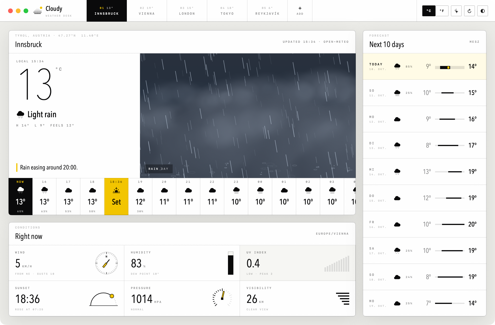
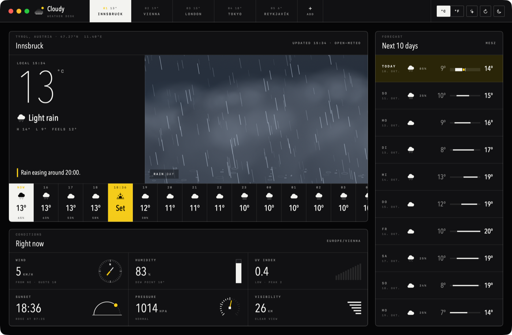
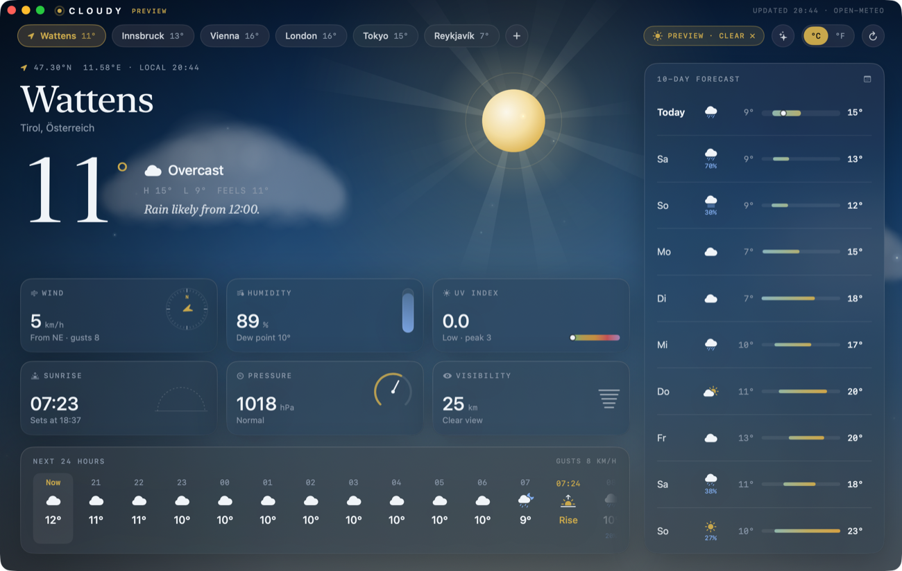
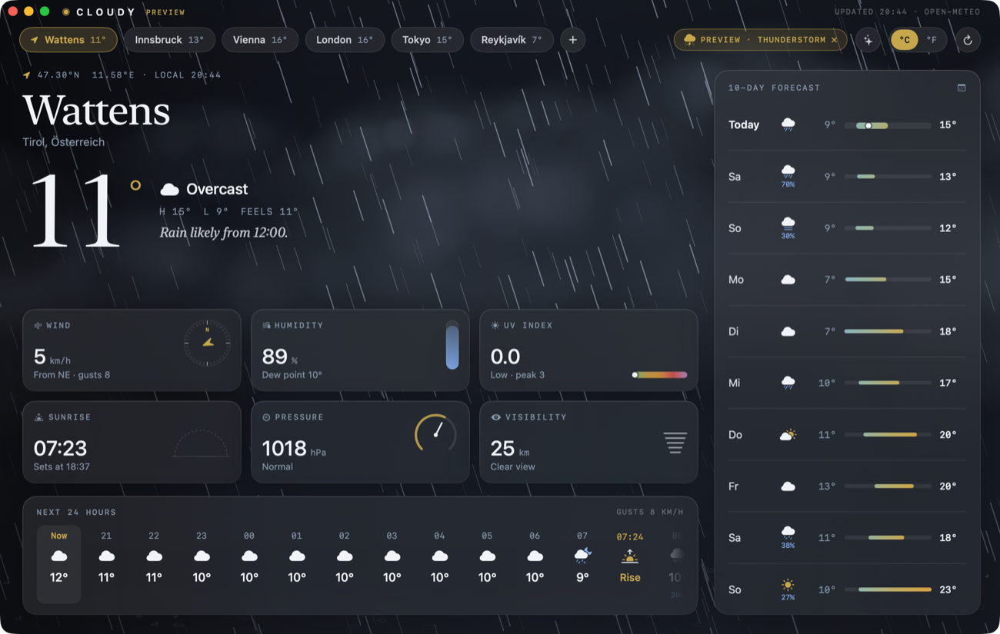
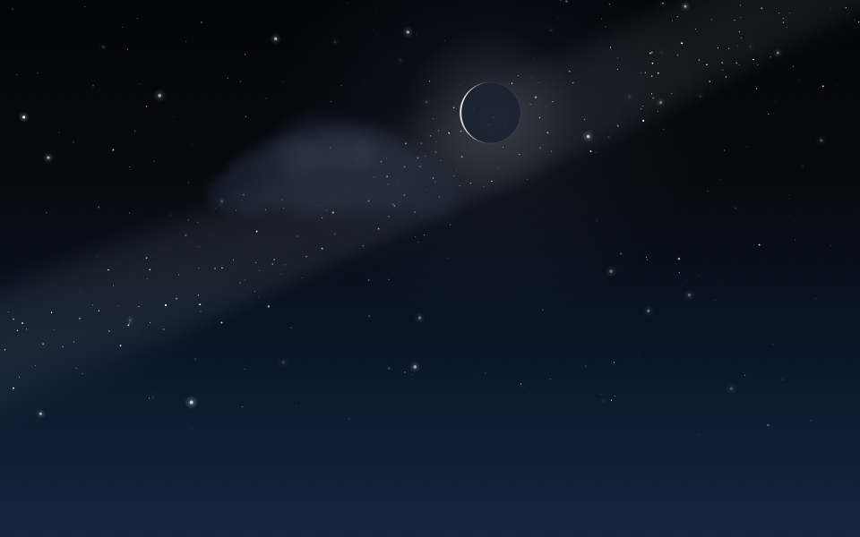
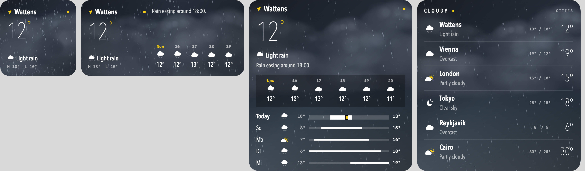
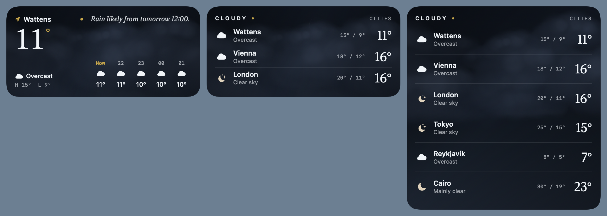

# Cloudy

A native macOS weather app with a live, animated sky for every kind of weather. It is styled like
its siblings [Times](https://github.com/Replace-Big-Tech-Apps/Times), [Quill](https://github.com/Replace-Big-Tech-Apps/Quill)
and [Calcium](https://github.com/Replace-Big-Tech-Apps/Calcium): V3ERA desk widgets with paper cards, black ink,
hairlines, tiny tracked monospace labels, Avenir Next Condensed numerals and one yellow signal color.
Light, dark or system appearance.




| Clear day | Thunderstorm |
|---|---|
|  |  |

## Skies

Fifteen animated atmospheres, each with a day and a night version, shown in the main card. The scene
cross-fades whenever the weather or the time of day changes.

| Sky | What moves |
|---|---|
| Clear | Slowly turning god rays and golden dust motes by day. Twinkling stars, the Milky Way, shooting stars and the **real current moon phase** by night |
| Mostly clear / Partly cloudy | Three parallax layers of procedurally painted, drifting clouds |
| Overcast | A cloud ceiling with dense cloud layers |
| Fog | Rolling fog banks and ground haze, with a pale sun behind them |
| Windy | Curling wind streaks, tumbling gold leaves and fast clouds |
| Drizzle / Rain / Heavy rain | Depth-layered rain slanted by the real wind speed, with ripple splashes |
| Thunderstorm | Procedurally branched lightning with multi-pulse flicker that lights the whole sky |
| Hail | Hailstones that bounce off the ground and pile up |
| Freezing rain / Sleet | Ice pellets with frost crystals growing in the window corners |
| Snow / Blizzard | Swaying flakes with depth, or a wind-driven whiteout |

The sky also shifts slightly as you move the pointer over it (parallax).

| | | |
|---|---|---|
|  |  |  |
|  |  |  |

## Features

- Live data from [Open-Meteo](https://open-meteo.com): current conditions, the next 24 hours
  (with sunrise and sunset), a 10-day forecast, wind, humidity, UV, pressure and visibility. No API key needed.
- A one-line summary of what's coming next, e.g. *"Rain easing around 17:00."*
- City search (⌘K) and your current location
- °C / °F
- Light / dark / system appearance (the button in the top bar, or Settings with ⌘,)
- **Atmosphere preview** (✨ button or the *Atmosphere* menu, ⌘1–⌘9) shows any sky on demand, by day or by night

## Widgets

Desktop and Notification Center widgets, each with a still frame of the sky behind it:

- **Cloudy** (small, medium, large) shows the city selected in the app: temperature, conditions, H/L, a
  one-line forecast, the next few hours and (large) five days.
- **Cloudy Cities** (medium, large) shows up to six saved cities at a glance. Tap a row to open that city.




To add one, right-click the desktop, choose **Edit Widgets…** and search for **Cloudy**. The widgets refresh
every half hour and step through the hourly forecast between fetches. When you change cities or units in
the app, the widgets update right away.

Widgets need a real signing identity (an *Apple Development* certificate is enough).
`build_app.sh` picks yours automatically, or uses `CODESIGN_IDENTITY` if you set it. It signs the sandboxed
extension and shares data through the App Group `<TEAM_ID>.dev.cloudy`. Without an identity, the app still
builds, just without widgets. To preview every widget size with live data, without adding them:

```bash
scripts/widget_snapshots.sh ./widget-snapshots
```

## Build & run

Requires Xcode and macOS 14 or later.

```bash
./scripts/build_app.sh
```

```bash
open Cloudy.app
```

To make a disk image that installs Cloudy into Applications (drag-and-drop, with a SHA-256 checksum next to it):

```bash
./scripts/make_dmg.sh
```

During development:

```bash
DEVELOPER_DIR=/Applications/Xcode.app/Contents/Developer swift run
```

Extras:

```bash
open Cloudy.app --args --preview thunderstorm --night   # start in a preview sky
.build/debug/Cloudy --gallery ./gallery                 # render every sky to PNG
```

### Design

Design tokens (colors, radii, fonts) and the shared controls (`WidgetCard`, `SquareButton`, `Chip`,
`BarButton`) live in `Sources/Cloudy/Design/Theme.swift`, the same set Times uses. The fonts, Avenir Next
Condensed and the system monospace, ship with macOS, so there's nothing to install.

## Keyboard

| | |
|---|---|
| ⌘K | Search cities |
| ⇧⌘L | Use my location |
| ⌘R | Refresh |
| ⌘[ / ⌘] | Previous / next city |
| ⌘1…⌘9 | Preview a sky |
| ⇧⌘N | Toggle day / night |
| ⌘0 | Back to live weather |

## How it works

```
Sources/Cloudy/
├── App/        CloudyApp (window, menus), WeatherStore (state, persistence, refresh)
├── Design/     Theme (V3ERA tokens, fonts, cards, controls), glyphs, window chrome
├── Model/      WeatherKind (WMO code → sky), Forecast, units/formatting
├── Services/   OpenMeteo (forecast + geocoding), LocationProvider
├── Scene/      SceneConfig, SpriteBank, SceneRenderer, WeatherScene, Gallery
└── Views/      TopBar (city segments), Hero (sky + hourly), 10-day, conditions, search
Widgets/        WidgetKit extension (provider, views, bundle) + snapshot harness
```

The widget extension is compiled with `swiftc` from `Widgets/` plus the shared sources listed in
`scripts/shared_sources.sh`. `build_app.sh` embeds it in `Cloudy.app/Contents/PlugIns`.

Each sky is a single SwiftUI `Canvas` drawn by a `TimelineView` at 60 fps. Every particle's position is a
pure function of (index, time), so there's no simulation state to manage. Clouds and fog are painted once
by Core Graphics as stacks of soft radial gradients and cached, so frames never need a blur pass.
